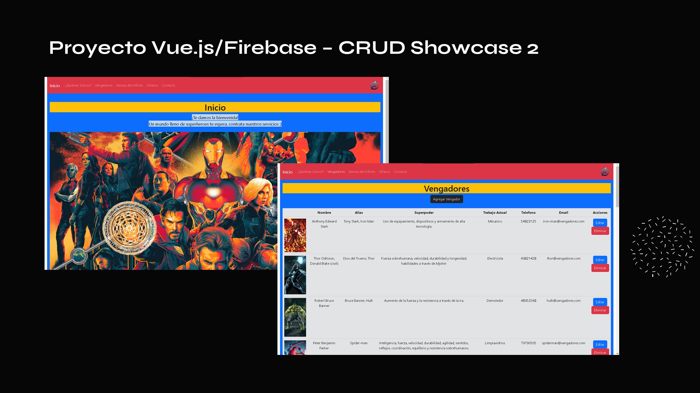

# CRUD Showcase 2 — Vue.js y Firebase (Temática Marvel)

Aplicación web SPA temática de Marvel desarrollada con **Vue.js**, **Vue Router**, **Bootstrap 5** y **Firebase Realtime Database**, con operaciones CRUD para gestionar Vengadores, Villanos y Gemas del Infinito, además de un formulario de contacto.

## Vista previa

## Características principales

- **Navegación SPA:** Enrutamiento en el cliente mediante **Vue Router** (`Inicio`, `¿Quiénes Somos?`, `Vengadores`, `Gemas del Infinito`, `Villanos` y `Contacto`).
- **CRUD de Vengadores:** Listado, creación, edición y eliminación de registros (`nombre`, `alias`, `superpoder`, `trabajo_actual`, `telefono`, `email` e imagen).
- **CRUD de Villanos:** Listado, creación, edición y eliminación de registros (`nombre`, `superpoder`, `origen`, `derrotado_por` e imagen).
- **CRUD de Gemas del Infinito:** Listado, creación, edición y eliminación de registros (`nombre`, `poder`, `portador`, `ubicación` e imagen).
- **Contacto:** Formulario de solicitud con selector dinámico de Vengador y validación en el cliente.

## Tecnologías utilizadas

- **HTML5** y **JavaScript**
- **Vue.js 2** y **Vue Router**
- **Axios** y **Fetch API** (consumo REST de **Firebase Realtime Database**)
- **Bootstrap 5.2.2** (vía CDN)

## Contexto y estado del proyecto

- **Contexto:** Aplicación frontend temática con operaciones CRUD desarrollada en noviembre de 2022 con fines académicos.
- **Estado:** Finalizado (archivado para portafolio).
- **Configuración de Firebase:** Los endpoints en `recursos/vistas/` y `recursos/componentes/` utilizan la URL genérica `https://tu-proyecto-default-rtdb.firebaseio.com`. Para usar una instancia propia, crea una base de datos en Firebase Realtime Database, reemplaza ese dominio por la URL de tu proyecto y configura las reglas de seguridad correspondientes en Firebase.

## Autor

**Daniel Alejandro Arita Leiva**
